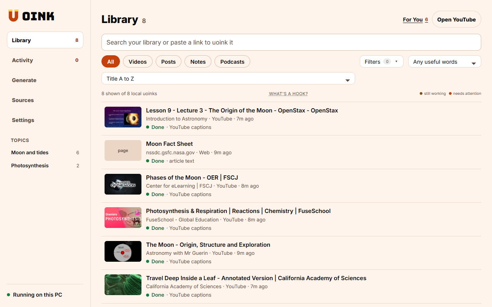
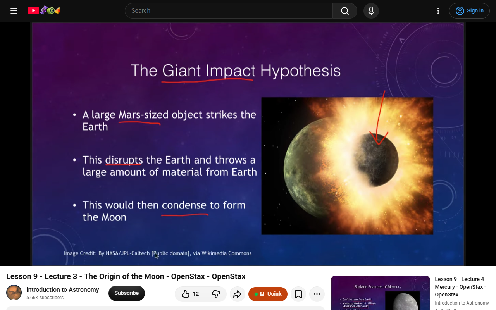
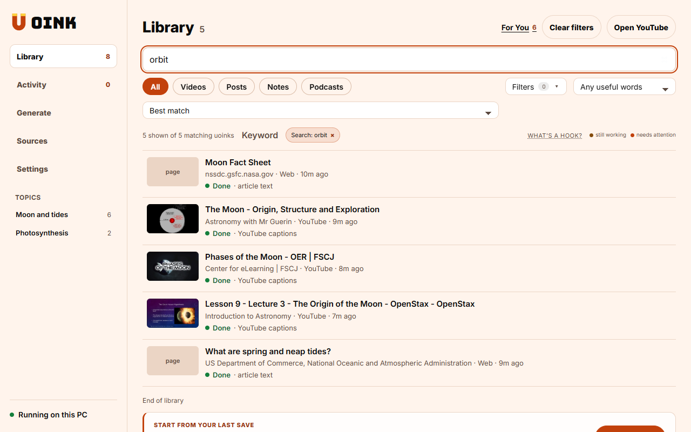

<p align="center">
  <a href="https://uoink.app"></a>
</p>

<h1 align="center">Uoink</h1>

<p align="center"><b>Save what you watch. Your AI cites it to the minute.</b></p>

<p align="center">
  A local library of YouTube videos, podcasts, X posts, Reddit threads and web pages, with full transcripts.<br>
  Claude, Cursor or Codex searches all of it and quotes the exact timestamp.
</p>

<p align="center">
  <a href="https://uoink.app/get"><b>Download</b></a> ·
  <a href="https://uoink.app">Website</a> ·
  <a href="docs/connect-your-agent.md">Connect your AI</a> ·
  <a href="https://uoink.app/developers">Developers</a> ·
  <a href="CHANGELOG.md">Changelog</a>
</p>

<p align="center">
  <a href="https://github.com/ryanbiddy/uoink/releases/latest"></a>
  <a href="https://uoink.app/get"></a>
  <a href="LICENSE"></a>
  <a href="https://glama.ai/mcp/servers/ryanbiddy/uoink"></a>
</p>

<p align="center">
  
</p>

**[Download for Windows or Mac](https://uoink.app/get)**, or use Homebrew on a Mac. Then connect your AI:

```sh
brew install --cask ryanbiddy/uoink/uoink
uoink connect claude-code --write
```

Paste a YouTube link into an AI chat and it guesses. Paste the transcript and the timestamps are gone, so when it says "they mention this around the middle" you can't check.

Uoink is a YouTube transcript MCP server that remembers. Save a video once and the whole thing lands on your computer: transcript, screenshots, top comments and channel details. Your AI reads the real words and tells you the minute they were said.

A transcript fetcher grabs the captions for one video when asked and keeps nothing. Uoink keeps everything you save in one library, so your AI can search across months of videos, podcasts and posts at once.

- **Yours.** Free and open source (MIT). No account, no Uoink cloud. Files stay on your disk as Markdown and JSON.
- **Any AI you already use.** Claude Desktop, Claude Code, Cursor, Codex and 40+ more over MCP, plus a CLI.
- **Every platform.** Windows 10/11, Mac (Apple silicon, macOS 15+) and [Linux](docs/linux.md).

## What it does

**Save it.** Click the Uoink button under a video, press `Alt+U`, paste a link into the dashboard, or tell your agent to do it. Videos without captions are transcribed on your machine with Whisper.

**Find it.** One search covers every transcript, post and page you've saved. Each hit comes with its source and timestamp.

**Write from it, with receipts.** Your AI quotes what you saved and links the moment. Ask it which of your saved talks disagree, or run a research playbook over the library.

```text
You:  uoink https://youtu.be/... and tell me where they explain the eval setup
AI:   They cover it at 14:32. "We run every prompt against 200 held-out cases..."

You:  which of my saved talks disagreed about that?
AI:   Two of them. Talk A (08:15) argues for it. Talk B (41:02) says it breaks at scale.
```

## Quick start

1. **Install.** Download from **[uoink.app/get](https://uoink.app/get)**, or on a Mac run `brew install --cask ryanbiddy/uoink/uoink`. For Linux, see [the Linux guide](docs/linux.md).
2. **Connect your AI.** Run `uoink connect claude-code --write` and confirm. If `claude` is on PATH, Uoink adds the server for you. Restart Claude Code and ask “What's in my Uoink library?” For other clients, run `uoink connect --list`. Claude Desktop can also open the `.mcpb` file from the [latest release](https://github.com/ryanbiddy/uoink/releases/latest).
3. **Ask.** *"uoink https://youtu.be/… and tell me where they explain the eval setup."*

Good to know: the Windows installer is unsigned, so SmartScreen asks first (choose **More info → Run anyway**). The Mac app is signed and notarized. The browser button loads from the app's setup screen while the Chrome Web Store listing is pending.

## What you can save

| Source | What Uoink keeps |
|---|---|
| **YouTube** | Timestamped transcript, screenshots, top comments, channel details, full metadata |
| **Podcasts** | Feeds you follow, with new episodes transcribed on your computer if you turn that on |
| **X posts and videos** | Post text, video transcript, author credit and thread context. Long posts and X Articles save in full from the open tab |
| **Reddit** | The thread and its top comments |
| **Web pages** | Readable article text, including pages that need a sign-in when you save from the open tab |
| **Whole shows** | A YouTube channel, playlist or podcast feed, up to 5,000 episodes, with the time and disk space shown first |

You can also import YouTube Watch Later, X bookmarks and Reddit saves, and [share links from your phone](docs/relay.md).

<p align="center">
  
  
</p>

## Works with your AI

| Client | How to connect |
|---|---|
| **Claude Desktop** | Open the `.mcpb` file from the [latest release](https://github.com/ryanbiddy/uoink/releases/latest). [Details](docs/mcpb-bundle.md) |
| **Claude Code** | `uoink connect claude-code --write`, or the plugin: `claude plugin marketplace add ryanbiddy/uoink-agent-kit` |
| **Cursor** | `uoink connect cursor --write` uses the 36-tool core set. |
| **Codex, VS Code and more** | `uoink connect --list` lists 48 clients and integrations. Use `uoink connect <client>` to preview a recipe. |
| **Any agent with a shell** | The `uoink` command: `uoink search "working memory" --limit 5` |
| **ChatGPT or any chat box** | Click Uoink and paste. The transcript and key screenshots land on your clipboard |

The stdio transport is tested with **Claude Desktop and Cursor**, and Claude Code is checked on each release's install receipt. Cline and Continue are standard-stdio compatibility paths, not individually smoke-tested. Full list, config files and limits: [Connect your agent](docs/connect-your-agent.md).

## For agents and developers

- **MCP server:** a local MCP server with 99 tools over stdio, five library resource templates and eleven prompts. Set `UOINK_MCP_TOOLSET=core` for 36 tools or `research` for the 7 research tools. [Tool reference](docs/v2-mcp.md)
- **One launch line for any MCP client:** `"command": "uoink", "args": ["mcp"]`. [Setup by client](docs/connect-your-agent.md#one-launch-command-for-any-mcp-client)
- **HTTP and OpenAPI:** the same tools at `http://127.0.0.1:5179/mcp/v1` (send the `X-Uoink-Token` header) and an OpenAPI 3.1 surface. Local OpenAPI-capable agents and scripts can drive the same tools through `/openapi/v1/spec.json` and `POST /tools/<name>`.
- **CLI:** `uoink status`, `uoink search`, `uoink recent`, `uoink note`, `uoink cues <id>`. Local reads work without the app running.
- **Skill:** a [portable skill](skills/uoink/SKILL.md) for finding saved evidence, citing timestamps and capturing links. Clients that support Agent Skills can load the same file next to the MCP tools or use its CLI commands (Claude Code, Codex, pi, Hermes Agent and OpenClaw).
- **Research:** [video deep research](docs/research.md) finds sources, checks quotes and timestamps, and publishes a cited report. Six playbooks run over saved captures with no API key and no network calls: `outlier-posts`, `transcript-intel`, `comment-mining`, `creator-teardown`, `repurpose-pack` and `thesis-check`.
- **Agents installing Uoink for someone:** follow [llms-install.md](llms-install.md).

## Install, step by step

1. **Download the installer.** Download `Uoink-Setup-3.18.1.exe` from the [v3.18.1 release](https://github.com/ryanbiddy/uoink/releases/tag/v3.18.1). For Windows 10/11; Mac steps are below. The installer is unsigned: if SmartScreen shows "Windows protected your PC", choose **More info -> Run anyway**, and check the file against the SHA-256 listed on the release page.
2. **Run it.** Defaults install to `%LOCALAPPDATA%\Uoink\` (no admin required). The finish page can launch the helper immediately, and an autostart entry runs it on each login.
<!-- store-install:start -->
3. **Load the bundled extension.** On the one-time setup splash, click **Open extensions page** to open your browser's extensions page. If you get a blank tab, enter the address shown on the splash. Click **Copy path** on the splash to copy the installed extension path. Turn on **Developer mode**, click **Load unpacked**, and select that folder. Pin **Uoink** from the browser's Extensions menu.
<!-- store-install:end -->

**On a Mac** (Apple Silicon, macOS 15 or later; preview): download `Uoink-3.18.1-macos-arm64.dmg` from the same release, drag Uoink to Applications, eject the disk and open Uoink from Applications. The app is signed and notarized, so macOS only asks its usual question about apps downloaded from the internet. Then load the extension from the setup splash as above. See [docs/mac/INSTALL.md](docs/mac/INSTALL.md).

The store install link is controlled by [store-config.json](extension/store-config.json). When the listing is live, the setup splash and these steps offer **Add to Chrome**, with sideloading under **Advanced**. Release maintainers: follow [SUBMIT-NOW.md](docs/store/SUBMIT-NOW.md).

On Linux, including Docker and headless agent sandboxes, see [docs/linux.md](docs/linux.md).

```sh
git clone https://github.com/ryanbiddy/uoink && sh uoink/scripts/linux/install.sh
```

For developers running from source, see [REQUIREMENTS.md](./REQUIREMENTS.md). Build the installer locally with `./build.ps1` (see [docs/build-installer.md](./docs/build-installer.md)).

## Phone inbox (optional)

Share a link from your phone's share sheet and Uoink captures it on your
computer, with no phone app. Three steps in **Settings > Capture > Phone
inbox**: deploy a small relay to your own (free) Render account, connect it,
then scan a QR code with your phone. The relay holds only the link and an
optional note, until Uoink picks it up or for 7 days at most.

[](https://render.com/deploy?repo=https://github.com/ryanbiddy/uoink)

Setup, the manual Shortcut fallback and the free-plan tradeoffs are in
[docs/relay.md](docs/relay.md).

## Privacy

Your saved corpora, screenshots, podcast audio, transcripts, library index and
diagnostic logs stay on your computer. Uoink has no account or cloud library.

Uoink sends no usage data by default. If you turn on "Share anonymous usage counts", it sends daily counts to usage.uoink.app: calls by tool name, known MCP clients, stdio or HTTP calls, captures by source and result, and library searches. Reports include a random install ID, app version, operating system and major version, processor type, install type and hours counted. They never include content, URLs, titles, paths, search text, usernames, IP addresses or account details.

Sharing is off by default. In Dashboard > Settings > App > Usage sharing,
"See what is sent" shows the next report and the last ten sent reports with
their dates. Turning sharing off deletes the random ID, local counts and
sent history. UOINK_USAGE_SHARING=0 forces it off.

See the [usage payload and counting design](docs/usage-sharing.md).

Capture fetches the source you ask for. Podcast watches poll feeds you enable;
Auto-ingest can also download new episodes. Long X posts and Articles that X
cuts short use FxTwitter only if you turn that switch on (off by default).
Transcription can download models with
your consent, and **Check now** (or the daily update check, off by default) contacts GitHub
for release information.

Optional AI features send relevant source text to Anthropic only with your own
API key. Comment Intelligence, Hook Type classification and entity extraction
are off by default; agent-requested analysis also requires your key. The key is
stored in the OS credential store. Content you pass to an AI client is handled
under that client's policy.

Read the [Uoink privacy policy](https://uoink.app/privacy).

## Docs

| Guide | What's in it |
|---|---|
| [Connect your agent](docs/connect-your-agent.md) | Setup for every client, toolsets and limits |
| [MCP tool reference](docs/v2-mcp.md) | All 99 tools, both transports, playbooks and discovery |
| [Video deep research](docs/research.md) | Find, capture, verify and publish |
| [Linux and Docker](docs/linux.md) | Headless installs for agents and sandboxes |
| [Mac install](docs/mac/INSTALL.md) | The signed app, the extension and the `uoink` command |
| [Phone inbox](docs/relay.md) | Share links from your phone |
| [Notifications](docs/notifications.md) | Keep background captures quiet |
| [Usage sharing](docs/usage-sharing.md) | The opt-in counts, field by field |
| [Security](SECURITY.md) | How to report a problem |

## Contributing

Bug reports and pull requests are welcome. Start with [CONTRIBUTING.md](CONTRIBUTING.md). To run from source, see [REQUIREMENTS.md](./REQUIREMENTS.md).

Ideas and questions go in [Discussions](https://github.com/ryanbiddy/uoink/discussions); bugs go in [Issues](https://github.com/ryanbiddy/uoink/issues).

## Disclaimer & Terms of Use

Uoink is designed and built for personal research, study, and original creator drafting. Users are solely responsible for ensuring that their use of captured media (transcript text, screenshots, and comments) complies with the Terms of Service, copyright policies, and API guidelines of YouTube, Reddit, X (Twitter), and any other source platforms. Uoink does not host, share, or claim ownership over third-party media.

## License

MIT. See [LICENSE](./LICENSE). Third-party components and their licenses are listed in [THIRD-PARTY-NOTICES.md](./THIRD-PARTY-NOTICES.md).

## Changelog & roadmap

See [CHANGELOG.md](./CHANGELOG.md) for version history and [ROADMAP.md](./ROADMAP.md) for what's next.

---

*Built by [Ryan Biddy](https://github.com/ryanbiddy).*
